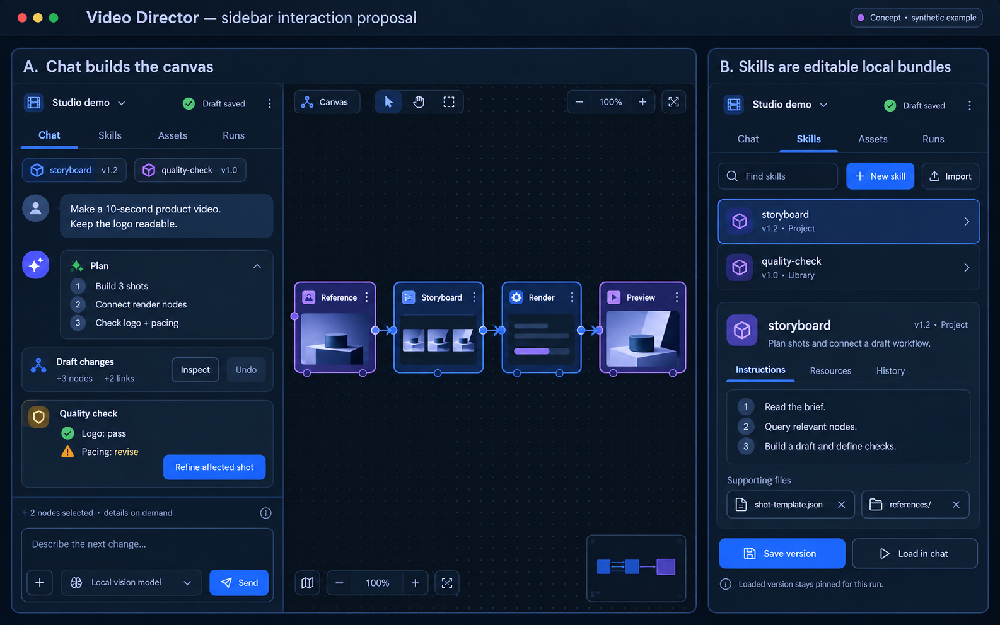
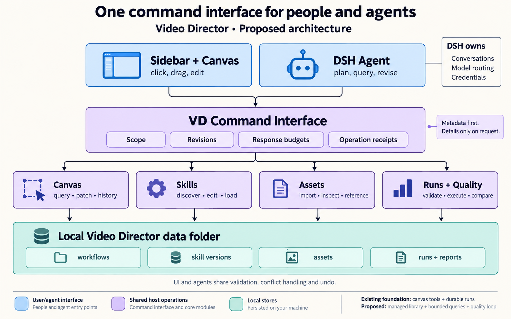
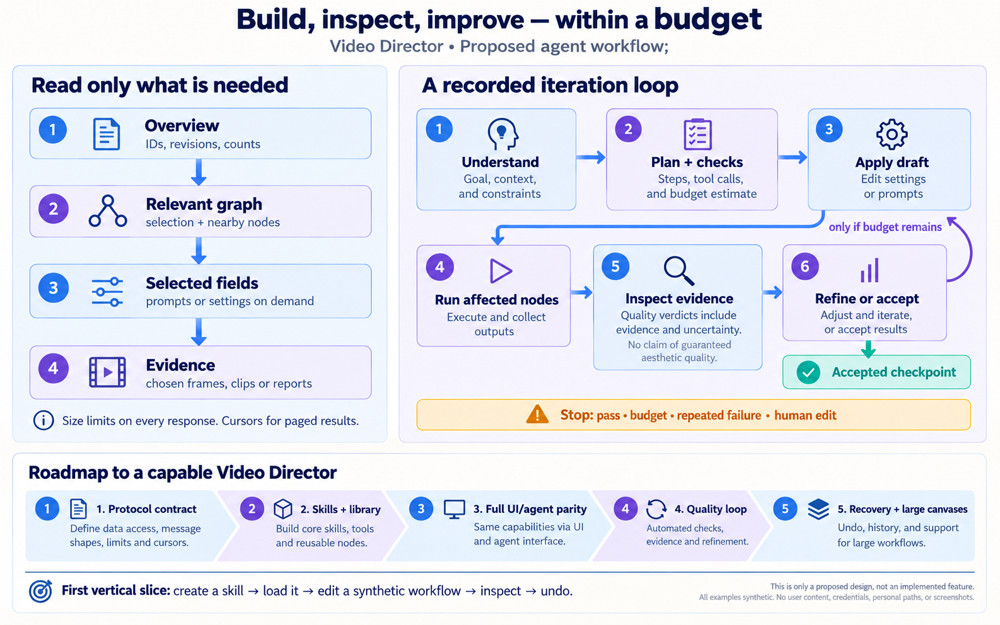

# Sidebar, skills, and agent-driven workflows

Design proposal, 18 October 2026. Target: `uncensored`, plugin commit `caeb69a`, DSH `0.2.1-rc.2`. This document proposes behavior; it does not implement it. All examples and visuals are synthetic. No private workflow contents, media, conversations, or credentials were inspected for this proposal.

Implementation follow-up, 19 October: see [Sidebar agent workspace](../../agent-workspace.md) for shipped behavior, commands, tests, and differences from this proposal.

## Recommendation

Make the sidebar the control surface for a shared, local Video Director workspace. People and agents should invoke the same operation handlers for skills, canvas edits, assets, execution, and history. Keep DSH in charge of conversations, model routing, tool execution, and credentials.

Start with a complete small workflow: create a skill in the sidebar, save a version, load it into the linked chat, build a synthetic canvas through commands, inspect a result, and undo an edit. Define the command and context contracts first, then make skills the first user-visible addition. Extend the existing canvas implementation rather than introduce a second graph format or an independent agent framework.

The important distinction is between a skill, a workflow, and a run. A skill supplies reusable instructions; a workflow is the editable graph; a run is an immutable execution snapshot. Loading a skill does not execute it, and editing a skill must not silently change an in-flight run.

## What exists today

| Surface | Verified implementation | Remaining work |
|---|---|---|
| Compact chat context | `DirectorController.currentContext()` supplies project identity, revisions, counts, and tool guidance; it omits node prompts/scripts. | Add bounded selection and active-skill references; explicit context accounting. |
| Canvas tool | `vd_canvas` supports summaries, paged nodes/edges, selected node fields, definitions, references, assets, and providers. | Versioned discovery, graph-neighborhood queries, revision-bound cursors, common response budgets. |
| Editing | `editVdCanvas` is shared by editor/host code; `mutateDraft` applies an atomic batch under a revision check and returns a summary. | Route all persistent UI actions through the same command handlers; durable operation history and undo. |
| Runs and inspection | Host-owned run/cancel/status, properties, explicit image inspection, frame extraction, and transcription already exist. | Recorded quality criteria, comparisons, iteration budgets, checkpoints, and controlled continuation. |
| Storage | Configurable `dataDir`, staged folder moves, `projects/`, `assets/`, and `workflows.json` already exist. | Managed skills, reusable recipes/checklists, version records, and indexes inside that root. |
| Skills | The plugin registers the bundled `comfyui-workflow-to-node` skill with DSH. DSH has a scoped registry, filesystem providers, discovery, and a native loader. | Sidebar authoring, project bindings, revisions, resource operations, and bounded exposure to the model. |

Existing pagination is a foundation, not an end-to-end output-size guarantee. For example, node reads can request up to 20 fields with excerpts of 8,000 characters each; a large node definition or individual run/job result can still be substantial. List item limits do not bound serialized bytes. DSH's native skill loader also returns the complete instruction body, and its catalog updates replace the whole visible list. These are specific reasons to add limits in the host implementation.

## Sidebar interaction

Use four tabs beneath a persistent workflow header: **Chat**, **Skills**, **Assets**, and **Runs**. On narrow sidebars, keep the same destinations in an overflow menu. The current workflow and linked session remain clear when changing tabs.

**Chat** keeps the conversation primary. Show compact active-skill chips, references to selected nodes/assets, a short plan card, an applied-changes card with Inspect/Undo, and run/quality cards. Clicking a node reference selects and frames it on the canvas. Canvas selection can be attached to a message by reference; it does not automatically copy every selected field into the model request. A context inspector explains which names, fields, skill versions, and media samples would be shared.

**Skills** supports search/filter, New, Import, Duplicate, Edit, Save version, Load in chat, Unload, and Archive. An editor provides Instructions, Resources, and History views. Show separate statuses: Available, Selected for this workflow, and Loaded in this conversation. A newer library revision should show “Update available,” not replace a loaded version. Bundled skills are read-only; editing one creates a managed copy with a distinct identity.

**Assets** provides reusable media, references, templates, and recipes. Project assets remain scoped to their workflow unless explicitly published to the shared library. The sidebar shows thumbnails locally; only an explicitly selected, permitted sample is admitted to the model. Skills reference asset IDs or relative bundle resources rather than embedding media bytes in instructions.

**Runs** shows execution status, outputs, quality evidence, failed checks, and iteration history. Actions include cancel, inspect an output, compare with the best prior result, and resume from a checkpoint. User-facing cards describe changes and evidence; raw protocol envelopes belong in an optional developer view.

Useful interaction example:

1. User loads `storyboard` and says, “Make a 10-second product video; keep the logo readable.”
2. The agent retrieves the overview, relevant definitions, and the referenced product input.
3. A plan card names the intended shots and checks. Under an existing edit authorization, the agent applies a reversible draft batch.
4. The canvas updates and highlights the changed nodes. The card reports “3 nodes added, 2 links added.”
5. Execution uses the user's selected model/providers and configured iteration allowance.
6. A quality card reports evidence, for example “Logo: pass; pacing: revise.” The agent changes the affected shot and reruns its dependent outputs.
7. The best acceptable result becomes a named checkpoint; unresolved subjective choices remain visible for the user.

## Architecture and ownership

The external seam is a small **VD command interface**, called by a browser adapter and a DSH tool adapter. Its implementation owns scope validation, argument validation, revision checks, response projection, size limits, operation receipts, and event publication. Four internal modules hold the behavior: Canvas, Library, Assets, and Runs/Quality. Their storage implementations can evolve without changing every caller.

Keep `vd_canvas` compatible. Add `vd_library` for managed skills/resources and introduce a run/quality interface as needed; existing `vd_canvas run/job/cancel` calls can delegate to the same handlers during migration. Do not advertise dozens of separate tools with large schemas. A small capabilities response lists operation names and summaries; `describe` supplies the schema for one requested operation.

The browser uses authenticated DSH Connection RPC. The agent adapter derives identity from the executing DSH session. Both resolve the same authorized workflow/library scope before calling the host operation. A request's `projectId`, a skill's instructions, or a supplied `sessionId` never grants additional access.

Persistent commands work without a mounted browser. View commands such as selecting nodes, fitting the viewport, opening a preview, and focusing an editor use a connected-view adapter and return `VIEW_UNAVAILABLE` when there is no target view. There is no need to require a browser for graph edits just because their visual effect appears on a canvas.

## Managed data directory

Extend the existing chosen data folder; do not create another competing root or place personal skills in the plugin checkout. The following is a proposed additive layout, not a migration already performed:

```text
<Video Director data folder>/
  projects/<project-id>/              existing project and run storage
    library-bindings.json            selected skill revisions and asset links
    quality/                         criteria, reports, iteration checkpoints
    operations/                      receipts and reversible edit records
  assets/                            existing media bytes and asset index
  workflows.json                     existing workflow/definition registry
  library/
    skills/<skill-id>/
      working/<skill-name>/
        SKILL.md
        references/
        assets/
        scripts/                     optional; execution stays policy-controlled
      versions/<revision>/           immutable complete bundle snapshots
    recipes/                         reusable graph templates, with versions
    checklists/                      reusable quality criteria
    asset-links/                     shared-library membership by asset ID
    index.json                       derived, rebuildable metadata index
  cache/                             derived search indexes and thumbnails
```

Preserve existing asset paths initially; a reusable library reference must not silently transfer ownership or make another project's private asset visible. Import/export is an explicit operation with a manifest. Asset retention must account for references from workflows, skill versions, and run evidence. Archive is reversible; garbage collection is separate from ordinary deletion.

Keep skills compatible with the Agent Skills `SKILL.md` bundle format. Put Video Director-specific IDs, digests, revisions, scope bindings, and index metadata in sidecar records; portable metadata extensions must remain string-valued where required by the format. Prefer a small instruction file plus focused references and templates. A proposed managed-skill instruction cap is 16 KiB, with a smaller authoring target; reject oversized bodies with an actionable split suggestion rather than silently truncating their instructions.

The folder chooser and storage-move implementation already exist. Extend their drain/copy/activate process to include the library and to rebind the skill provider after activation. Verify recovery and indexes after a move. Do not copy credentials or conversation history into this root: those stay under DSH ownership.

## DSH skill integration

Reuse DSH's registry and native loading behavior through an adapter backed by the managed library. `vd_library` owns search, create, edit, validate, version, archive, bind, and resource queries. The DSH skill adapter advertises only a small selected set for the owning agent and returns the pinned instruction version. Library-wide search stays paged and on demand.

Do not register the entire writable library globally via `customSkillDirs` as the final design. That is a useful simple discovery option, but it does not establish Video Director project isolation and can grow the model catalog. Different VD projects can share a filesystem cwd. Use their actual linked session/project identities and DSH's agent scope. A phase-one integration proof must demonstrate two agents with the same cwd seeing different project skill selections; the registry supports scoped lookup, but the binding/invalidation lifecycle still needs implementation and tests.

Use one loading path per invocation. A skill loaded by a direct user gesture must not be injected again through a duplicate tool call. Record the skill ID, version, and digest with the operation/run. Resource reads resolve inside the pinned bundle, are bounded, and report their digest. Saving a new skill version updates discovery while existing runs retain their original instruction and resource versions. Imported scripts remain files until an explicitly authorized execution path runs them.

Removing a skill from the active set stops future activation; it cannot erase instruction text already retained in conversation history. Expose that distinction and offer a fresh conversation when strict separation is required.

## Compact canvas protocol, proposed v1

Keep the current protocol vocabulary where it works. Add a versioned envelope and machine-readable schemas. These examples are illustrative, not callable APIs yet.

```json
{
  "protocol": "vd/1",
  "requestId": "request-demo-17",
  "projectId": "project-demo",
  "command": "query",
  "args": {
    "entity": "nodes",
    "selector": {"ids": ["render-2"], "direction": "upstream", "hops": 1},
    "fields": ["id", "type", "title", "status"],
    "atDraftRevision": 42,
    "limit": 20,
    "maxBytes": 8192
  }
}
```

```json
{
  "protocol": "vd/1",
  "requestId": "request-demo-17",
  "ok": true,
  "draftRevision": 42,
  "items": [{"id": "render-2", "type": "video", "title": "Shot 2", "status": "idle"}],
  "page": {"returned": 1, "nextCursor": null},
  "omitted": [],
  "usage": {"unit": "utf8-bytes", "limit": 8192},
  "etag": "demo-node-view-42"
}
```

| Read level | Default response | Explicit escalation |
|---|---|---|
| Overview | Identity, revisions, node/edge counts, selected IDs, bounded active-skill references | No whole graph or node contents |
| Relevant graph | Paged node summaries and bounded upstream/downstream neighborhoods | Filters, IDs, depth, and selected edge fields |
| Selected fields | Whitelisted fields from requested nodes | Bounded text excerpts or nested subfields with continuation |
| Evidence | Asset metadata and references to reports/artifacts | Specific frame(s), clip, transcript range, or report section |

Proposed initial limits are configurable host ceilings: automatic context 2 KiB; ordinary read response 8 KiB; explicit detail response 16 KiB; 20 items by default and 50 maximum; explicit media requests use a separate size/sample limit. Bytes are enforced against the serialized envelope, not guessed token counts. These are starting design values to benchmark with the supported models, not measured performance claims.

The host must apply limits to success results, errors, definitions, job records, batch rows, help text, and nested fields. If a record will not fit, return a small reference, omission description, and continuation cursor; never cut JSON arbitrarily or silently drop a field. Media bytes never appear as incidental JSON fields. Node content, resource text, transcripts, and diagnostics remain data even when they contain apparent instructions.

Cursors bind to scope, query, field projection, and a snapshot revision. A graph edit invalidates an old graph cursor with `STALE_CURSOR`; job progress uses its own execution cursor so it does not invalidate graph pagination. Add conditional reads by revision/ETag and a bounded `changes(sinceRevision)` feed. When old change history expires, return a compact resync instruction. The model should receive changed IDs and current state instead of repeated full histories.

An edit request supplies `expectedDraftRevision`, an idempotency key, and a bounded batch of typed operations. A successful receipt gives the operation ID, new revision, affected IDs, compact diff counts, and a reversible checkpoint reference. Reusing a key with identical inputs returns its receipt; different inputs produce an explicit conflict. Validation and commit happen under the same project write lock. Keep the current transactional operations; add dry-run validation and preview before expensive execution.

Undo is a revision-checked inverse operation or checkpoint restore, not a blind replacement of the entire graph. If a human changed the affected state, return a conflict with the small relevant diff. Generated runs and already incurred costs are not undone when graph edits are reversed.

Common errors should be structured and bounded: `REVISION_CONFLICT`, `STALE_CURSOR`, `INVALID_OPERATION`, `CONTENT_NOT_SHARED`, `BUDGET_EXHAUSTED`, `CAPABILITY_UNAVAILABLE`, and `VIEW_UNAVAILABLE`, each with the smallest useful recovery hint.

## Human/agent operation parity

Maintain an operation manifest as the checklist for parity. Each semantic UI operation names its host command or view command, input schema, required capability, event, and undo/recovery behavior. Test the browser adapter and agent adapter against the same operation receipts.

| Human action | Equivalent agent operation |
|---|---|
| Create/edit/import/version/load/archive a skill | Managed-library commands plus the shared skill activation path |
| Add/configure/move/connect/clone/delete/freeze nodes | Typed canvas edit batch |
| Select/frame/zoom/open preview or inspector | Targeted connected-view commands |
| Create/rename/duplicate/import/export/organize a workflow | Workflow lifecycle commands |
| Import/attach/crop/trim/sample media; edit a sketch or mask | Asset commands with IDs, declared formats, and explicit upload or vector/mask inputs |
| Run/cancel/retry/compare/revert | Durable run and history commands |
| Install/remove a custom node or workflow definition | Registry commands with version/dependency checks |
| Choose model or provider settings | DSH-backed settings commands; secret entry stays in DSH's credential interface |
| Move the storage folder | Host storage operation with validated destination and active-work checks |

File choosers, clipboard access, and downloads need platform adapters. Agents supply a validated asset/source/destination reference instead of trying to manipulate the chooser dialog. Secret values are never returned by parity commands. A capability can legitimately require human credential entry or a connected view; it must return that requirement explicitly rather than pretending success. Mouse hover itself does not need a durable event; its meaningful result, such as highlight or inspect, has a view command.

## Quality-check iterations

Represent the brief and evaluation criteria as a versioned run plan. Record graph revision, node-definition versions, model settings, seeds where supported, input digests, skill versions, and the allowed execution budget. Start with one agent using a host-owned coordinator, not a new multi-agent hierarchy.

The proposed state machine is `planned → validated → running → inspecting → needs-revision | accepted | stopped`. A revision returns to validation, preserving every earlier output and report. The coordinator stores checkpoints and receipts; DSH remains responsible for actual agent turns and tool execution. Existing durable jobs survive browser closure, but that alone does not create new model turns after the current turn finishes. Automated continuation is a separate, explicit DSH lifecycle/scheduling integration.

Use two kinds of checks:

- Deterministic checks: graph validity, missing inputs, output existence, duration/dimensions/format, required shot count, and machine-checkable timing constraints.
- Perceptual checks: logo readability, style consistency, pacing, audio quality, and instruction adherence, using a suitable configured model or a human evaluator. Every verdict records evidence references, sampled regions/timestamps, confidence or uncertainty, and a short reason. Use `pass`, `fail`, `unknown`, or `needs-human`; missing evidence cannot become a pass. Speech transcription alone does not establish audio quality, and sparse frames cannot establish every temporal property.

Inspect the smallest useful evidence set first. Request further frames/clips when a criterion requires temporal evidence. Revise only relevant nodes and invalidate their downstream results using dependency/input digests. Preserve the best prior result if a later iteration regresses. Human canvas changes pause or branch the agent plan; they must not be overwritten by a stale continuation.

Stop on satisfied criteria, the iteration/time/provider-call allowance, repeated equivalent failure, no improvement, a human interruption, or a new capability requirement. Reserve budget before scheduling work. Treat monetary costs as estimates unless the provider offers enforceable pricing; use hard call/iteration limits when pricing is unavailable. Resume after restart by reconciling recorded operations with provider/job status, not by blindly resubmitting work.

## Content sharing and local operation

Local storage does not mean a cloud model cannot receive content: loading skill instructions or inspecting an image can disclose that selected material to the configured model. The UI must expose this plainly through the context inspector and a persisted sharing policy. For the user's current metadata-only restriction, a cloud agent may receive allowed IDs/names/status and execute authorized edits, but attempts to read private node text or media must return `CONTENT_NOT_SHARED` until the user changes that scope.

A protocol-level rule is insufficient if the same DSH agent can read the data directory through unrestricted filesystem, shell, or other tools. The selected DSH agent composition and tool permissions must enforce the same scope. Test this before describing the workflow as private. Do not treat a skill file or arbitrary node text as permission to expand access. These rules apply to the proposed implementation; this design work used only source code, public documentation, and synthetic examples.

## Delivery sequence and acceptance criteria

| Phase | Deliverable | Exit criterion |
|---|---|---|
| 1. Contract and integration proof | `vd/1` schemas, operation manifest, response budgets, DSH scope/loading proof | Same-cwd projects remain isolated; oversized nested responses are bounded; stale edits/cursors fail clearly. |
| 2. Skills and library | Managed directory, skill/resource CRUD, versioning, project selection, Skills tab | A person and agent create/edit/load the same synthetic skill; edits survive restart; active runs keep their pinned version. |
| 3. Canvas parity and history | UI actions use common handlers, connected-view commands, receipts and undo | Equivalent human/agent actions produce equivalent state; interleaved edits recover without losing either side. |
| 4. Bounded quality loop | Criteria, evidence reports, affected-node reruns, best-result retention | Synthetic fixture reaches pass or a recorded stop within its allowance, including failures and human interruption. |
| 5. Recovery and scale | Crash reconciliation, storage moves, migration, export, context measurements | Large synthetic canvases near today's 2,000-node/5,000-edge limits remain bounded; restart does not duplicate provider work. |

Measure bytes and model-token estimates per turn, number of tool calls, time to the first useful edit, undo success, conflict recovery, provider calls per accepted result, and human correction rate. Run real media/provider trials only after the contract tests, using disposable inputs and an explicit execution allowance.

The first milestone is deliberately a full small slice, not a broad agent framework: **create skill → save version → load → query → edit synthetic canvas → inspect → undo**. Quality-loop automation follows once this slice has reliable scope, history, and context behavior.

## Visuals and design files

The accompanying generated concept images are explanatory proposals. This document and the editable Mermaid files are authoritative if a generated label or arrow is imperfect. Images use invented project/skill names and contain no user workflow content. Generation prompts are saved in `image-prompts.json` for review.

### Sidebar interaction concept

The two panels show the proposed Chat and Skills experiences. The run cards, quality results, and product media are invented examples. They do not report a real execution.



### Shared command architecture

People and agents enter through separate adapters and reach the same host operations. DSH retains conversation, model, and credential ownership. Editable source: [architecture.mmd](architecture.mmd).



### Context, iteration, and delivery plan

The disclosure ladder bounds reads; the recorded loop bounds execution and refinement. Editable source: [iteration.mmd](iteration.mmd).



Images were generated with the built-in image-generation tool. The final iteration diagram received a targeted correction recorded in `image-revisions.json`.

## Sources and implementation entry points

- [Agent Skills specification](https://agentskills.io/specification): portable `SKILL.md` bundles, optional resources, and progressive loading. The managed revisions, host budgets, and VD commands above are this proposal, not requirements of that standard.
- [DSH skill registry at rc.2](https://github.com/deepseek-ai/deepseek-harness/blob/687f282e8625c6b8d11ff58211a90524be2e4317/packages/skill/skill/README.md), inspected from the matching local checkout: scoped providers and list/load separation.
- [DSH filesystem provider at rc.2](https://github.com/deepseek-ai/deepseek-harness/blob/687f282e8625c6b8d11ff58211a90524be2e4317/packages/skill/skill-filesystem/README.md), inspected locally: custom roots and change invalidation.
- [DSH skill consumer at rc.2](https://github.com/deepseek-ai/deepseek-harness/blob/687f282e8625c6b8d11ff58211a90524be2e4317/packages/skill/tool-skill/README.md), inspected locally: full instruction loading, retained tool history, whole-catalog updates, and current limits.
- Existing plugin code: `src/canvas-agent.js`, `src/client/canvas-commands.ts`, `src/client/controller.ts`, `src/project-store.js`, `src/director-host.js`, `src/storage.js`, `src/index.js`, and `test/canvas-agent.test.js`.
- Existing design history: `docs/sidebar-chat-architecture-2026-09-28.md`. Its old counts and commit-state wording are historical; the source inspection above describes the current branch.
